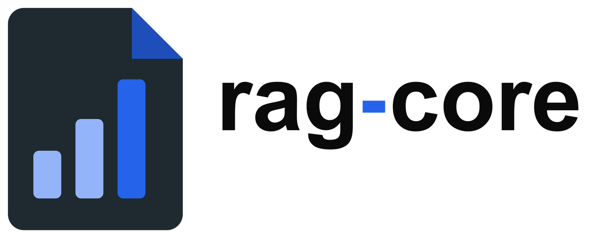
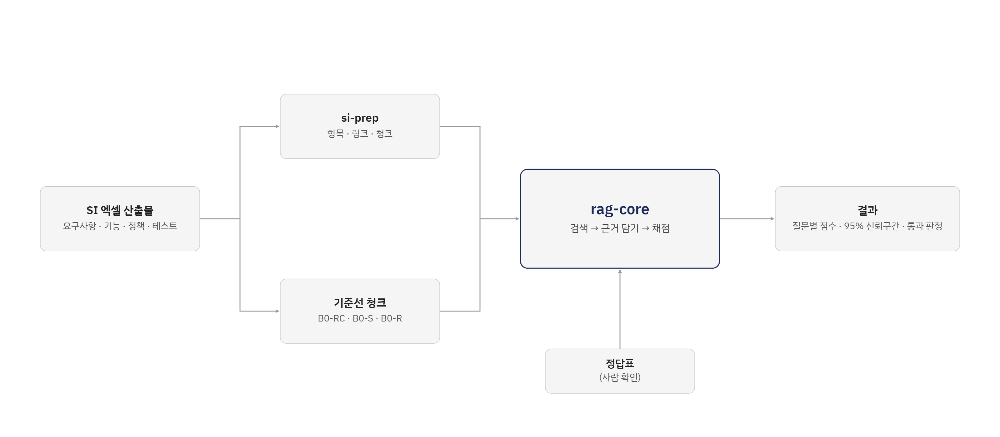
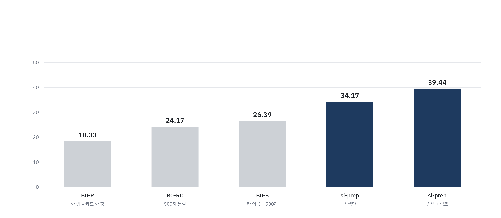
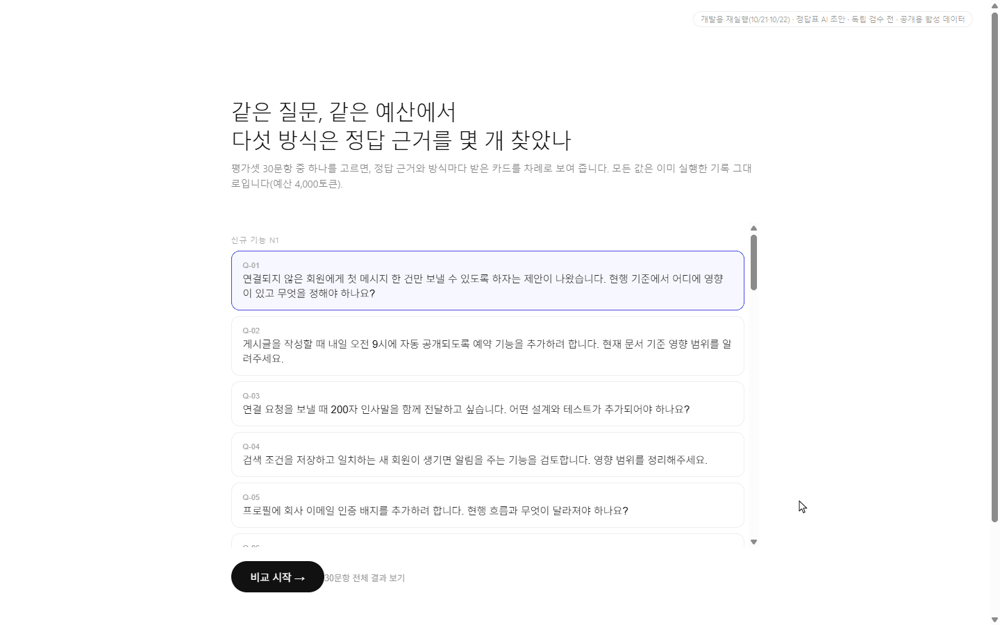
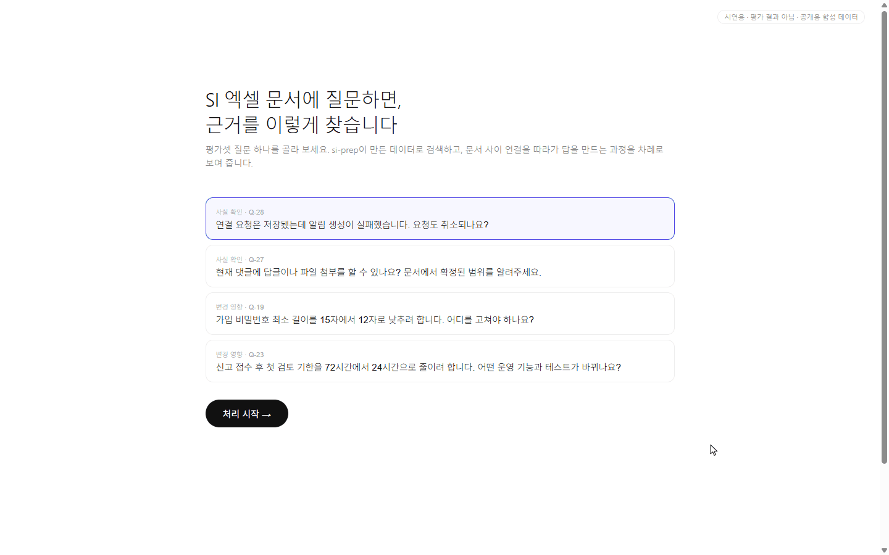

<p align="center">
  <picture>
    <source media="(prefers-color-scheme: dark)" srcset="docs/images/logo-dark.png">
    
  </picture>
</p>

<p align="center">
  <i>전처리가 정말 검색을 낫게 했는지, 같은 조건에서 숫자로 확인하는 RAG 평가 코드</i>
</p>

<p align="center">
  
  
  
  
  
</p>

<p align="center">
  <a href="#무엇을-확인했나">무엇을 확인했나</a> ·
  <a href="#결과">결과</a> ·
  <a href="#한-질문이-처리되는-모습">시연</a> ·
  <a href="#직접-실행하기">직접 실행하기</a> ·
  <a href="https://github.com/sSFireFoxSs/si-prep">si-prep</a>
</p>

> **베타(v0.1.0)입니다.** 팀 프로젝트의 SI 문서 다섯 세트로 검증했지만, si-prep 출력 스키마 1.2~1.4에 맞춰져 있고 설정 형식과 결과 파일 칸은 0.x 동안 바뀔 수 있습니다. 평가 데이터와 정답지는 포함하지 않았습니다.

---

## 무엇을 확인했나

SI 프로젝트 문서 중 엑셀로 작성된 요구사항·정책·기능·테스트 문서를 대상으로 합니다. 이런 문서는 머리글·분류 같은 표 구조와 문서 사이의 ID 참조에 의미가 담겨 있는데, 행이나 글자 수로만 잘라 임베딩하면 이 정보가 청크에서 빠집니다.

전처리 도구 [si-prep](https://github.com/sSFireFoxSs/si-prep)은 엑셀을 항목 단위 청크로 만들고, 분류 경로와 문서 간 링크(같은 ID, 같은 분류 경로)를 복원합니다. rag-core는 **si-prep 청크가 흔히 쓰는 청킹 방식보다 정답 근거를 더 많이 찾는지를 같은 조건에서 비교하는 검색·평가 코드**입니다. 점수는 사람이 확인한 정답 근거 행을 찾아왔는지로만 매기며, LLM 채점은 쓰지 않습니다.

| 특징 | 내용 |
|---|---|
| 같은 조건 비교 | 기준선 3종과 si-prep 2종을 같은 임베딩(bge-m3), 같은 근거 예산(4,000토큰), 같은 후보 수(100)로 비교합니다. |
| 정답 근거로만 채점 | 질문마다 필수 근거 행을 찾아왔는지(회수율)를 코드가 셉니다. LLM 채점은 쓰지 않습니다. |
| 우연과 구분 | 질문 단위 쌍대 부트스트랩 10,000회로 95% 신뢰구간을 내고, 하한이 0보다 클 때만 통과로 봅니다. |
| 기준 동결 | 평가 전에 코드·설정·정답표·입력의 지문을 동결하고, 하나라도 바뀌면 평가용 실행을 멈춥니다. |
| 링크 따라가기 | 검색으로 찾은 항목에서 si-prep 링크를 한 칸 따라가 함께 볼 근거를 더 담습니다. |
| 로컬 실행 | 임베딩은 로컬에서만 실행하며, 외부 API 호출은 기본으로 막혀 있습니다. |

<p align="center">
  
</p>

## 결과

공개용 합성 SI 문서 세트(서비스 E, 엑셀 5개, 질문 30개)의 결과입니다. 결과 전에 방식과 판정 기준을 등록하고 한 번만 실행했습니다. 데이터와 정답지는 이 저장소에 없습니다.

<p align="center">
  
</p>

| 방식 | 청킹 | 회수율(%) |
|---|---|---|
| B0-R | 엑셀 한 행 = 카드 한 장 | 18.33 |
| B0-RC | 글자를 500자씩 자르기 | 24.17 |
| B0-S | 행을 "칸 이름: 값"으로 바꾼 뒤 500자씩 | 26.39 |
| si-prep 검색만 | 분류 경로가 붙은 si-prep 청크로 검색 | 34.17 |
| si-prep 검색 + 링크 | 검색한 뒤 링크로 이어진 항목까지 | **39.44** |

B0-R·B0-S·B0-RC는 전처리 없이 흔히 쓰는 청킹 기준선입니다.

- si-prep 검색 + 링크는 기준선 3종을 모두 앞섰습니다: B0-RC **+15.28** [+5.56, +25.56] · B0-S **+13.06** [+1.67, +25.00] · B0-R **+21.11** [+12.22, +30.56] (%p, 95% 신뢰구간, 모두 하한 > 0)
- si-prep 검색만 − B0-R = **+15.83** [+9.44, +22.22]
- **링크 자체의 효과**(검색 + 링크 − 검색만)는 +5.28 [−2.22, +12.50]으로 **확인하지 못했습니다.**
- 다른 데이터에서는 차이가 없었던 경우도 있어, "구조화가 항상 이긴다"고 보지 않습니다.

비교별 상세, 예산 사용량, 보조 지표, 재현성은 [평가 결과 상세](docs/평가결과_상세.md)에 있습니다.

## 한 질문이 처리되는 모습

같은 질문(Q-02)·같은 예산에서 다섯 방식이 받은 카드와 찾은 정답 근거 단위를 차례로 보여 주는 시연 화면입니다. 이 질문에서는 기준선 3종이 0/2, si-prep 검색만이 1/2, si-prep 검색 + 링크가 2/2를 찾았습니다. 질문 하나의 예시이며, 값은 같은 설정으로 다시 실행한 기록입니다(회수율·신뢰구간이 위 결과와 같음).

<p align="center">
  
</p>

<details>
<summary>찾은 근거로 LLM이 답하는 화면 보기 (Q-28)</summary>

검색 → 링크 따라가기 → LLM에 전달 → 답 작성 순서입니다. 답의 인용 번호를 누르면 근거 카드와, 링크 카드가 어느 카드에서 이어졌는지가 보입니다. 답은 로컬 LLM(EXAONE 3.5 7.8B)을 한 번 실행한 기록입니다.

<p align="center">
  
</p>

</details>

시연 화면은 설명용이며 화면 코드와 데이터는 이 저장소에 없습니다.

## 직접 실행하기

평가에 쓴 si-prep 버전은 태그 `main-b1-frozen`(출력 스키마 1.4)입니다.

```sh
# 1. si-prep 설치(청크 검증에 스키마를 불러다 씁니다)
git clone https://github.com/sSFireFoxSs/si-prep
cd si-prep && git checkout main-b1-frozen && pip install -e . && cd ..

# 2. rag-core 설치
git clone https://github.com/joonki24/rag-core
cd rag-core && pip install -r requirements.txt
```

```sh
cd scripts/rag_core
# 정답지 엑셀 → 정답표, 사람이 확인
python gold_xlsx_convert.py convert <정답지.xlsx> <정답표 폴더>
python gold_xlsx_convert.py confirm <정답표 폴더> --by <이름> --reason <사유>

# 한 방식 실행(b0_r, b0_s, b1_search, b1_link)
python eval_runner.py --arm b1_link --chunks <chunks.jsonl> --links <links.jsonl> --items <items.jsonl> \
       --gold-dir <정답표 폴더> --out <출력 폴더> --purpose dev --chunk-build b1 --reindex

# 두 실행 비교(점수 차이, 95% 신뢰구간, 통과 판정)
python ../compare_runs.py --target <실행 폴더> --base <실행 폴더> --purpose dev
```

실제 출력 모양은 [출력 예시](docs/출력예시.md), 평가용 실행 절차는 [사용법](scripts/rag_core/README.md), 코드 구조는 [코드 안내](scripts/rag_core/코드_안내.md)에 있습니다.

## 한계

- 판정은 **검색 단계**까지입니다. LLM 답변의 품질은 재지 않습니다.
- 데이터마다 결과가 달랐습니다. 질문이 30개라 작은 차이는 가려내기 어렵습니다.
- si-prep 출력 스키마(1.2~1.4)에 맞춰져 있습니다. 다른 청크 형식을 쓰려면 어댑터를 바꿔야 합니다.

## 만든 사람

- 검색 · 평가 코드(rag-core) 설계 · 구현: Joonki Yoon
- 전처리 도구(si-prep) 설계 · 구현: KimSeungJu — [si-prep](https://github.com/sSFireFoxSs/si-prep)

## 라이선스

[MIT](LICENSE)
